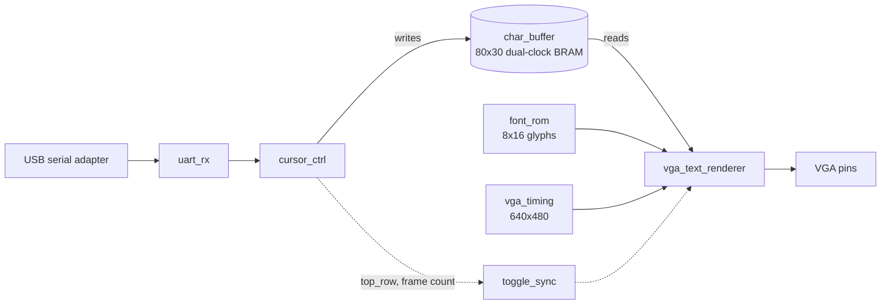

# UART to VGA Text Terminal on an FPGA


A serial text terminal written in Verilog for the Real Digital Blackboard (Zynq-7000, XC7Z007S). Plug a USB to serial adapter into a PMOD header, open any terminal program at 115200 baud, and whatever you type shows up on a VGA monitor and scrolls like a real terminal. All of it runs in the FPGA fabric. The ARM cores are never used.

I wanted something on a real board that shows serial protocol work and a video pipeline together, instead of another blinking LED project. The UART, the VGA timing, the frame buffer and the clock domain crossing are all written from scratch, with no vendor FIFO or CDC IP. Every number in this README comes from a small Python script in `scripts/` or from a simulation I ran, and I say which one each time.

<!-- Add a photo or short GIF of the monitor here, for example:  -->

## Quick Start

**Needs:** Vivado (2019.2 or newer), a Real Digital Blackboard, a USB to TTL serial adapter (3.3 V), and a monitor with VGA.

```
git clone https://github.com/HThakkar23/uart-vga-terminal
```

Open the Vivado Tcl console and run:

```
cd uart-vga-terminal
source scripts/create_project.tcl
```

That creates a project in `build/`, adds the RTL, testbenches, font data and constraints, and generates the clock wizard IP (100 MHz in, 100 MHz and 25 MHz out). It stops before synthesis so you can look around first. Then run synthesis, implementation and bitstream generation from the Flow Navigator and program the board.

Wire the adapter to PMOD header JC (adapter TX to board RX, adapter RX to board TX, shared ground) and open PuTTY or Tera Term at 115200, 8N1. Wait for the screen to go blank, then type.


## What it does

- 80 columns by 30 rows of text on a 640x480 screen
- Enter starts a new line and scrolls at the bottom, backspace erases, tab jumps to the next multiple of 8 columns
- The screen clears itself once at power up
- A switch puts the UART into a built in self test that sends known bytes, checks what comes back, and shows good and bad counts live on the LEDs

## Why build the UART instead of using the board's USB port

The Blackboard's USB to serial port is wired into the Zynq's processing system, the hard ARM side of the chip, not into the programmable logic where this design lives. Using it would mean writing software for the ARM cores. So the project has its own 8N1 transmitter and receiver in the fabric and talks out through two spare PMOD pins to an external adapter. The receiver uses 16x oversampling and rejects glitches on the start bit, and the baud rate choice is backed by an error table (below).

## How the design fits together



Two clock domains meet here. The UART and the text logic run at 100 MHz (`clk_sys`). The VGA timing and the renderer run at 25 MHz (`clk_pix`). The character buffer is a true dual-port block RAM with one port on each clock. That is the standard way to build a frame buffer when something other than the display logic writes into it, and the RAM handles the crossing for the character data itself.

Two values still need to cross the boundary by hand: the scroll position and the frame counter. They only change now and then, so they go through a small toggle synchronizer (`toggle_sync.v`) instead of a direct multi-bit crossing, which would not be safe.

### Scrolling without copying memory

The easy way to scroll is to copy every row up by one, which is 2,400 character writes. Instead the screen keeps a circular row pointer (`top_row`). The renderer starts drawing from that row, and a scroll only clears the one row that is about to become the new bottom line. That is 80 writes instead of 2,400, and it means the display never has to wait on a big copy.

## The numbers

Everything below comes from the scripts in `scripts/`. They only need a plain Python install.

**Baud rate** (`baud_calc.py`). The system clock is 100 MHz and the receiver oversamples 16x, so the divisor has to be a whole number:

```
     baud | divisor |  actual baud |    error
---------------------------------------------
     9600 |     651 |       9600.6 |   +0.01%
    19200 |     326 |      19171.8 |   -0.15%
    38400 |     163 |      38343.6 |   -0.15%
    57600 |     109 |      57339.4 |   -0.45%
   115200 |      54 |     115740.7 |   +0.47%
   230400 |      27 |     231481.5 |   +0.47%
   460800 |      14 |     446428.6 |   -3.12%  out of spec
   921600 |       7 |     892857.1 |   -3.12%  out of spec
```

At 115200 baud the divisor is 54, which gives 115,740.7 baud, 0.47% fast. UART framing handles that easily. One byte (start bit, 8 data bits, stop bit) takes 86.4 microseconds, so the ceiling is about 11,574 bytes per second. The 460800 and 921600 rows are marked out of spec because the 3.12% error is too close to what a receiver can tolerate.

**Video timing** (`vga_timing_calc.py`). 800 pixel clocks per line and 525 lines per frame is 420,000 pixel clocks per frame. The VESA pixel clock is 25.175 MHz, but a plain 25 MHz clock is what the clock wizard gives cleanly here, so the refresh rate comes out at 59.524 Hz instead of 59.94 Hz. Monitors accept that. The 80x30 grid of 8x16 cells fills the 640x480 active area exactly.

**Block RAM** (`bram_budget.py`). The XC7Z007S has 50 RAMB36 tiles.

| Memory | Size | RAMB36 tiles | Share of device |
| --- | --- | --- | --- |
| Character buffer, 80x30x8 bits | 19,200 bits | 1 | 2.0% |
| Font ROM, 128 glyphs x 8x16 | 16,384 bits | 1 | 2.0% |
| Worst case total | 35,584 bits | 2 | 4.0% |

That is the pessimistic count before Vivado packs anything. Check your own utilization report after implementation.

## A limitation I left in on purpose

The screen clears itself once at power up. That clear takes about 2,400 clock cycles, around 24 microseconds. If a byte arrives in that window it can be lost, because the design only holds one byte in reserve and the power up clear is longer than one byte period at this speed. So the rule is to wait for the screen to go blank before typing.

I did not want that to be a silent failure. Every dropped byte increments a `bytes_dropped` counter that you can watch on the LEDs. The 80 cycle clear after a normal scroll has more than 10x the margin and does not have this problem.

## Self test mode

Set `sw[0]` and the UART stops listening for typing. It sends itself a running byte counter and checks whatever comes back. Jumper TX to RX on the PMOD header and you get a throughput and error test of the serial link, with counts on the LEDs. `sw[3:1]` picks which counter the 8 stat LEDs show.

| `sw[3:1]` | LEDs show (low byte) |
| --- | --- |
| 000 | bytes received |
| 001 | bytes dropped |
| 010 | framing errors |
| 011 | video frame count |
| 100 | self test bytes sent |
| 101 | self test bytes good |
| 110 | self test bytes bad |
| 111 | current scroll offset (0 to 29) |

## Simulation

There is a self-checking testbench for the receiver, the transmitter and the VGA timing generator. I ran all three with Icarus Verilog 12 and all three print `PASS`:

| Testbench | Result |
| --- | --- |
| `tb_uart_rx` | 3 checks, 0 errors |
| `tb_uart_tx` | 20 checks, 0 errors |
| `tb_vga_timing` | 2 frames: 640x480 active pixels each, 96 clock hsync pulse on every line, one `frame_tick` per frame |

```
iverilog -g2012 -o sim_rx.out rtl/baud_tick_gen.v rtl/uart_rx.v sim/tb_uart_rx.v && vvp sim_rx.out
iverilog -g2012 -o sim_tx.out rtl/uart_tx.v sim/tb_uart_tx.v && vvp sim_tx.out
iverilog -g2012 -o sim_vga.out rtl/vga_timing.v sim/tb_vga_timing.v && vvp sim_vga.out
```

These cover the UART and the timing generator. The character buffer, cursor logic and renderer do not have a testbench yet, so that part of the design is only exercised by running it on the board.

## Repository structure

```
uart-vga-terminal/
├── constr/
│   └── blackboard.xdc          # pin constraints, UART and VGA blocks need checking
├── font/
│   └── font.mem                # generated 8x16 font ROM data
├── rtl/
│   ├── text_terminal_top.v     # top level
│   ├── uart_rx.v               # 8N1 receiver, 16x oversampling
│   ├── uart_tx.v               # 8N1 transmitter
│   ├── baud_tick_gen.v         # 16x oversample tick
│   ├── uart_bist.v             # built in self test
│   ├── cursor_ctrl.v           # bytes to screen writes, cursor, scrolling
│   ├── char_buffer.v           # 80x30 dual-port, dual-clock block RAM
│   ├── font_rom.v              # one ROM word per glyph scan line
│   ├── vga_timing.v            # 640x480 at 60 Hz timing
│   ├── vga_text_renderer.v     # character codes and font data to pixels
│   ├── toggle_sync.v           # slow counter clock domain crossing
│   ├── reset_sync.v            # reset release per clock domain
│   └── led_display.v           # live counters on the LEDs
├── scripts/
│   ├── create_project.tcl      # builds the Vivado project
│   ├── baud_calc.py            # baud divisor and error table
│   ├── vga_timing_calc.py      # refresh rate and grid size
│   ├── bram_budget.py          # block RAM usage
│   └── gen_font_rom.py         # makes font.mem (needs Pillow and a monospace TTF)
├── sim/
│   ├── tb_uart_rx.v
│   ├── tb_uart_tx.v
│   └── tb_vga_timing.v
└── SETUP.md                    # step by step build and bring up
```

`font/font.mem` is already in the repo, so you only need `gen_font_rom.py` if you want a different font. Point `FONT_PATH` at any monospace TTF.

## Areas for improvement

- **Color text.** Add an attribute byte next to each character code and use it to pick foreground and background colors.
- **ANSI escape codes.** Handle basic cursor movement sequences so full screen programs work.
- **A small shell.** A command interpreter that prints the live counters as text instead of LED patterns.
- **The power up drop window.** A one or two byte FIFO in front of `cursor_ctrl` would remove it. I left it visible and counted because the counter was more interesting to show than a quiet fix.

## References and resources

- Real Digital Blackboard: https://www.realdigital.org/hardware/blackboard
- AMD Zynq-7000 SoC Technical Reference Manual (UG585) and 7 Series Memory Resources (UG473) for the block RAM sizes
- TinyVGA 640x480 at 60 Hz timing: http://www.tinyvga.com/vga-timing/640x480@60Hz
- Clifford Cummings, "Clock Domain Crossing (CDC) Design and Verification Techniques Using SystemVerilog" (SNUG 2008), for the toggle synchronizer idea
